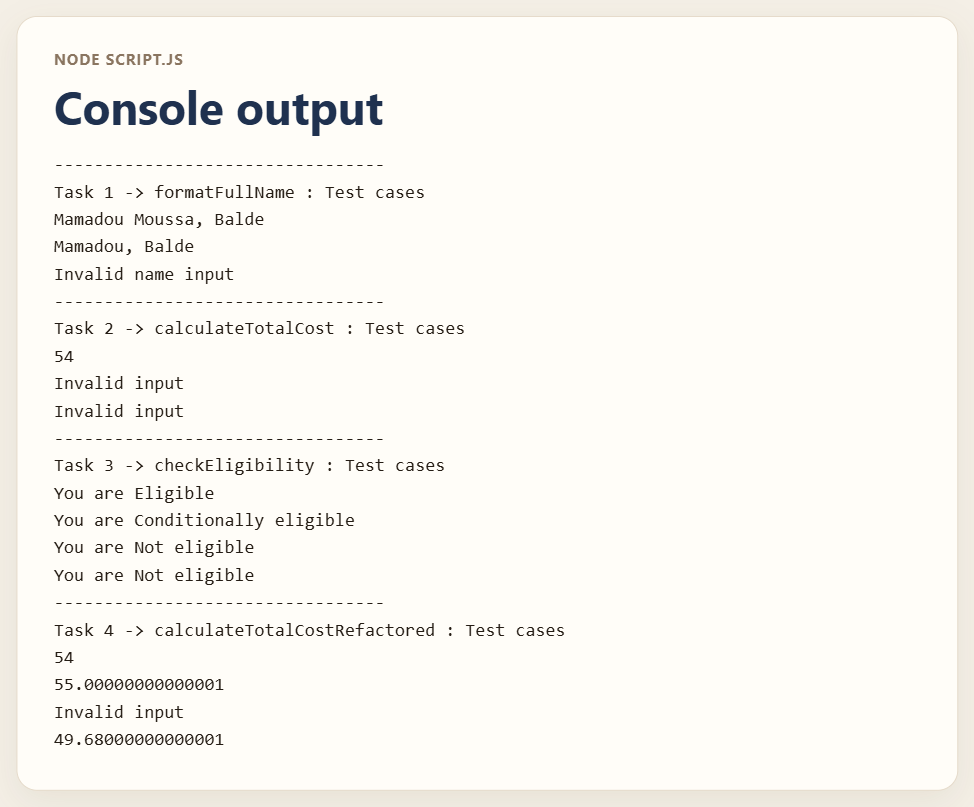

# Variables and Functions

A Node script with four functions and the test calls that print their results.

## Description

There is no HTML page. The screenshot is the console output from `node script.js`.

### `formatFullName`

`capitalizeFirstLetter` uppercases the first character and leaves the rest of the string as it was. `formatFullName` joins the two results with a comma and a space.

| Call | Printed result |
| --- | --- |
| `formatFullName("Mamadou Moussa", "Balde")` | `Mamadou Moussa, Balde` |
| `formatFullName("mamadou", "balde")` | `Mamadou, Balde` |
| `formatFullName("Mamadou Moussa")` | `Invalid name input` |

A missing first or last name returns `Invalid name input`. The third call has no last name, so `lastName` is `undefined`.

### `calculateTotalCost`

The total is `price * quantity * (1 + taxRate)`. Each argument must be a number. A string, a missing argument, or `NaN` returns `Invalid input`.

| Call | Printed result |
| --- | --- |
| `calculateTotalCost(10, 5, 0.08)` | `54` |
| `calculateTotalCost(10, 5, "0.1")` | `Invalid input` |
| `calculateTotalCost(10, 5)` | `Invalid input` |

### `checkEligibility`

Age 18 or older and employed returns `You are Eligible`. Age 18 or older and not employed returns `You are Conditionally eligible`. Any other age returns `You are Not eligible`. A missing age or employment value returns `Invalid input`.

| Call | Printed result |
| --- | --- |
| `checkEligibility(25, true)` | `You are Eligible` |
| `checkEligibility(25, false)` | `You are Conditionally eligible` |
| `checkEligibility(15, true)` | `You are Not eligible` |
| `checkEligibility(15, false)` | `You are Not eligible` |

An employed 15-year-old is not eligible. The age check comes first.

### `calculateTotalCostRefactored`

This version takes an optional `discount` that defaults to `0`. The discount is subtracted from the line total, and then tax is applied: `(price * quantity - discount) * (1 + taxRate)`. A missing price, quantity, or tax rate returns `Invalid input`. Unlike task 2, this version does not check that the arguments are numbers.

| Call | Printed result |
| --- | --- |
| `calculateTotalCostRefactored(10, 5, 0.08)` | `54` |
| `calculateTotalCostRefactored(10, 5, 0.1)` | `55.00000000000001` |
| `calculateTotalCostRefactored(10, 5)` | `Invalid input` |
| `calculateTotalCostRefactored(10, 5, 0.08, 4)` | `49.68000000000001` |

`10 * 5 * 1.1` and `(50 - 4) * 1.08` print with the extra floating-point digits shown above.

## Screenshots



## Getting Started

### Dependencies

* Node.js
* The file has no `package.json`

### Installing

No install step. Node runs the file directly.

### Executing program

```bash
node script.js
```

## Help

A missing first or last name returns `Invalid name input`. A non-number in `calculateTotalCost` returns `Invalid input`. `calculateTotalCostRefactored` does not check that the arguments are numbers, and some totals print extra floating-point digits.

## Authors

[Mamadou Moussa Balde](https://www.linkedin.com/in/2mb/)

## Version History

* Current local run
    * `node script.js` printed the four test groups in the screenshot

## License

This folder does not include a `LICENSE.md` file.

## Acknowledgments

* [README template](https://gist.github.com/DomPizzie/7a5ff55ffa9081f2de27c315f5018afc)

## Reflection Questions

### How did you approach creating more flexible functions with parameters?

Instead of hardcoding specific values inside the function, I looked for the data that might change each time the function is used and turned those into parameters. By doing this, I could pass different arguments into the function when calling it. This approach made my functions reusable for many different scenarios rather than being limited to just one specific task.

### What challenges did you face while incorporating conditional logic in your functions?

One of the main challenges was making sure I accounted for all possible edge cases using if, else if, and else statements. It was sometimes tricky to figure out the correct order for the conditions; I had to ensure the most specific conditions were checked first so the logic wouldn't evaluate incorrectly. I also had to carefully track what the function was returning inside each branch to avoid unexpected bugs.

### How does refactoring improve the readability and maintainability of your code?

Refactoring improves readability by cleaning up messy code and breaking down large, complicated chunks of logic into smaller, focused functions with clear, descriptive names. This makes the code much easier to read and understand at a glance. It improves maintainability because if I need to fix a bug or add a new feature later, I know exactly which small function to update instead of having to search through a massive, confusing script.
